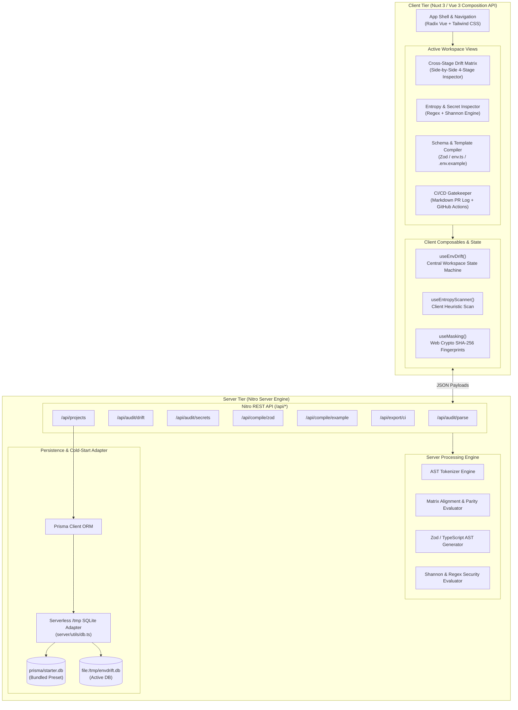
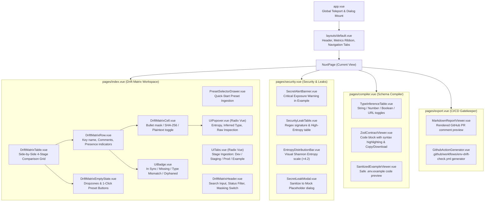

# System Architecture Document (ARCHITECTURE.md)
# EnvDrift Studio: Cross-Environment Configuration Auditor & Drift Guard

**Document Version:** 1.0.0  
**Target Release:** MVP v1.0  
**Author:** Principal System Architect  
**Status:** Approved for Implementation  
**Project Workspace:** `/Users/muttaqi/ai-engineering-team/projects/env-drift-studio`

---

## 1. System Architecture & High-Level Topology

### 1.1 Architectural Overview
EnvDrift Studio is designed as an autonomous, ultra-responsive configuration drift auditor, secret leak scanner, and schema compiler. The system operates on a dual-tier execution model:
1. **Client-Tier (In-Browser Execution):** Instantaneous AST parsing, real-time client-side Shannon entropy evaluation, Web Crypto SHA-256 fingerprinting, zero-knowledge masking, and dynamic matrix filtering. Sensitive environment values never leave the browser unless explicitly saved to local audit snapshots.
2. **Server-Tier (Nitro Engine & Prisma SQLite):** Headless API routes providing deterministic matrix normalization, AST tokenization verification, Zod schema generation, sanitized `.env.example` compilation, CI/CD export formatting, and persistent project snapshots in a local/serverless SQLite database (`/tmp/envdrift.db`).

### 1.2 High-Level Topology Diagram



### 1.3 Data & Request Flow Lifecycle
1. **Import Stage:** The user pastes raw text, drops `.env` files, or clicks a Quick-Start Preset. Raw text is captured into `useEnvDrift()`.
2. **AST Parsing:** Content is tokenized into typed AST nodes (comments, keys, values, multiline blocks, quotes).
3. **Matrix Alignment:** The cross-stage alignment engine unions all discovered keys across the four stages (`development`, `staging`, `production`, `example`), mapping each key to its stage presence, type classification, and drift status.
4. **Security Scan:** Simultaneously, values are evaluated against deterministic credential regex signatures (AWS, Stripe, GitHub, Slack, JWT, RSA keys) and Shannon entropy ($H(X) > 4.2\text{ bits/char}$).
5. **Zero-Knowledge Fingerprinting:** Native `window.crypto.subtle.digest` creates 64-character SHA-256 hashes of each cell's value. The UI renders truncated hashes (`sha256:7f9a...3c21`) or bullet masks (`••••••••`), keeping production credentials completely unexposed.
6. **Schema Compilation:** When the user navigates to the Compiler tab, inferred types are compiled into production-grade `@t3-oss/env-core` Zod schemas and sanitized `.env.example` templates.
7. **Snapshot Persistence:** Projects and audit reports are synced via `/api/projects` using Prisma ORM, seamlessly handling serverless `/tmp` cold starts.

---

## 2. Complete Technical Stack Specification

| Layer | Technology | Version | Rationale & Standards 3.0 Alignment |
| :--- | :--- | :--- | :--- |
| **Framework** | Nuxt 3 (App Engine) | `^3.14.0` | Server-side rendering + SPA hydration, file-system routing, automatic composable imports, and modular Nitro backend. |
| **Language** | TypeScript | `^5.5.0` | Strict type checking (`strict: true`), zero untyped `any` in core business logic. |
| **Component Architecture** | Vue 3 Composition API | `^3.5.0` | `<script setup lang="ts">` exclusively with high-performance reactive primitives (`ref`, `computed`, `watchEffect`). |
| **UI Primitives** | Radix Vue (`radix-vue`) | `^1.9.0` | Headless, accessible primitives (Dialog, Tabs, Popover, DropdownMenu, Tooltip, Accordion) ensuring full WAI-ARIA keyboard navigation and focus trapping. |
| **Styling** | Tailwind CSS (`@nuxtjs/tailwindcss`) | `^3.4.0` | Bespoke semantic color tokens, granular typography, no third-party bloated CSS frameworks. |
| **Icons** | `lucide-vue-next` | `^0.450.0` | 100% SVG iconography. **STRICTLY ZERO EMOJIS** in buttons, badges, headers, or toasts. |
| **Motion** | `@vueuse/motion` + Tailwind Transitions | `^2.2.0` | Micro-interactions with full `prefers-reduced-motion: reduce` accessibility safeguards. |
| **Persistence / ORM** | Prisma ORM with SQLite | `^5.19.0` | Zero-dependency local setup, instant schema migrations, robust serverless `/tmp` failover. |
| **Package Manager** | `pnpm` | `^9.0.0` | Deterministic dependency tree, fast installation, zero ghost dependencies. |

---

## 3. Complete Database Schema (`prisma/schema.prisma`) & Serverless DB Architecture

### 3.1 Schema Definition (`prisma/schema.prisma`)
The data model supports persistent workspaces, multi-environment snapshots with AST-parsed JSON, and immutable audit logs with health scores and drift counts.

```prisma
datasource db {
  provider = "sqlite"
  url      = env("DATABASE_URL")
}

generator client {
  provider = "prisma-client-js"
}

model Project {
  id           String                @id @default(uuid())
  name         String
  slug         String                @unique
  description  String?
  createdAt    DateTime              @default(now())
  updatedAt    DateTime              @updatedAt
  environments Environment[]
  auditReports AuditReport[]

  @@map("projects")
}

model Environment {
  id             String   @id @default(uuid())
  projectId      String   @map("project_id")
  project        Project  @relation(fields: [projectId], references: [id], onDelete: Cascade)
  stage          String   // "development" | "staging" | "production" | "example"
  fileName       String?  @map("file_name") // e.g., ".env.local", ".env.production"
  rawContent     String   @map("raw_content") // Unparsed .env source text
  parsedJson     String   @map("parsed_json") // Serialized AST token array & key map
  hash           String   // SHA-256 checksum of rawContent for change detection
  createdAt      DateTime @default(now()) @map("created_at")
  updatedAt      DateTime @updatedAt @map("updated_at")

  @@unique([projectId, stage])
  @@index([projectId])
  @@map("environments")
}

model AuditReport {
  id             String   @id @default(uuid())
  projectId      String   @map("project_id")
  project        Project  @relation(fields: [projectId], references: [id], onDelete: Cascade)
  healthScore    Int      @map("health_score") // 0 to 100 integer parity metric
  driftCount     Int      @map("drift_count")  // Total missing/diverged keys
  leakCount      Int      @map("leak_count")   // Total exposed secrets in public stages
  matrixJson     String   @map("matrix_json")  // Serialized cross-stage matrix snapshot
  createdAt      DateTime @default(now()) @map("created_at")

  @@index([projectId])
  @@map("audit_reports")
}
```

### 3.2 Serverless `/tmp` Cold-Start Database Adapter (`server/utils/db.ts`)
In serverless runtimes (such as Vercel Lambdas), the root filesystem is read-only. Only `/tmp` is writable. To guarantee zero-configuration out-of-the-box execution:
1. `server/utils/db.ts` checks if `/tmp/envdrift.db` exists.
2. If absent, it checks for a bundled seed database at `prisma/starter.db` or initializes a new SQLite schema.
3. It exposes a singleton `PrismaClient` with connection reuse across warm Lambda invocations.

```typescript
// server/utils/db.ts
import { PrismaClient } from '@prisma/client'
import fs from 'node:fs'
import path from 'node:path'

let prismaInstance: PrismaClient | null = null

export function getPrisma(): PrismaClient {
  if (prismaInstance) {
    return prismaInstance
  }

  const isServerless = process.env.VERCEL || process.env.AWS_LAMBDA_FUNCTION_NAME || process.env.NODE_ENV === 'production'
  
  if (isServerless) {
    const tmpDbPath = '/tmp/envdrift.db'
    if (!fs.existsSync(tmpDbPath)) {
      // Locate bundled starter database
      const candidatePaths = [
        path.resolve(process.cwd(), 'prisma/starter.db'),
        path.resolve(process.cwd(), 'prisma/dev.db'),
        path.resolve(__dirname, '../../prisma/starter.db')
      ]
      
      let seeded = false
      for (const src of candidatePaths) {
        if (fs.existsSync(src)) {
          fs.copyFileSync(src, tmpDbPath)
          seeded = true
          break
        }
      }
      
      if (!seeded) {
        // Fallback: create empty file; Prisma will initialize tables via push or schema
        fs.writeFileSync(tmpDbPath, '')
      }
    }
    process.env.DATABASE_URL = `file:${tmpDbPath}`
  } else if (!process.env.DATABASE_URL) {
    process.env.DATABASE_URL = 'file:./prisma/dev.db'
  }

  prismaInstance = new PrismaClient({
    datasources: {
      db: {
        url: process.env.DATABASE_URL
      }
    },
    log: process.env.NODE_ENV === 'development' ? ['warn', 'error'] : ['error']
  })

  return prismaInstance
}
```

---

## 4. Exact Directory and File Tree Layout

```
/Users/muttaqi/ai-engineering-team/projects/env-drift-studio/
├── .gitignore
├── .npmrc
├── ARCHITECTURE.md
├── CONCEPT.md
├── PRD.md
├── README.md
├── nuxt.config.ts
├── package.json
├── pnpm-lock.yaml
├── tailwind.config.ts
├── tsconfig.json
│
├── assets/
│   └── css/
│       └── main.css                     # Tailwind directives, font-tabular, dark theme scrollbars
│
├── components/
│   ├── ui/                              # Radix Vue Headless Wrapped Components
│   │   ├── UiBadge.vue                  # Semantic status badge (Healthy, Missing, Leak, Type)
│   │   ├── UiButton.vue                 # High-density accessible button (Primary, Outline, Ghost, Danger)
│   │   ├── UiCard.vue                   # Charcoal Slate card container (#111827)
│   │   ├── UiDialog.vue                 # Radix Dialog wrapper with focus trapping & blur backdrop
│   │   ├── UiDropdownMenu.vue           # Radix DropdownMenu for stage actions and exports
│   │   ├── UiInput.vue                  # Styled input field with hairline borders
│   │   ├── UiPopover.vue                # Radix Popover for cell detail & entropy inspection
│   │   ├── UiTabs.vue                   # Radix Tabs container (Dev, Staging, Prod, Example)
│   │   └── UiTooltip.vue                # Accessible tooltip for hashes and entropy hints
│   │
│   ├── matrix/                          # Matrix Core UI
│   │   ├── DriftMatrixTable.vue         # Main cross-stage side-by-side comparison grid
│   │   ├── DriftMatrixHeader.vue        # Filter toolbar: search, status filter, masking toggle
│   │   ├── DriftMatrixRow.vue           # Individual variable comparison row with status badge
│   │   ├── DriftMatrixCell.vue          # Value cell with SHA-256 fingerprint / bullet mask / unmask
│   │   └── DriftMatrixEmptyState.vue    # High-utility empty state with Quick-Start presets
│   │
│   ├── security/                        # Security & Entropy Inspection
│   │   ├── SecretAlertBanner.vue        # Critical leak notification for public stage exposures
│   │   ├── EntropyDistributionBar.vue   # Visual Shannon entropy indicator (bits/char)
│   │   └── SecretLeakModal.vue          # Remediation modal offering 1-click sanitization
│   │
│   ├── compiler/                        # Schema Generation UI
│   │   ├── ZodContractViewer.vue        # Rendered TypeScript / Zod env.ts code with copy/download
│   │   ├── SanitizedExampleViewer.vue   # Clean .env.example preview with comment preservation
│   │   └── TypeInferenceTable.vue       # Inferred primitive types & validation rule selector
│   │
│   ├── export/                          # CI/CD & Audit Reports
│   │   ├── MarkdownReportViewer.vue     # Formatted PR comment markdown preview
│   │   └── GithubActionGenerator.vue    # Drop-in .github/workflows/env-drift-check.yml viewer
│   │
│   └── presets/                         # Quick-Start Environment Presets
│       └── PresetSelectorDrawer.vue     # Next.js SaaS, Supabase + Stripe, Microservices API
│
├── composables/
│   ├── useEnvDrift.ts                   # Central application state machine and coordination
│   ├── useEntropyScanner.ts             # Mathematical Shannon entropy + regex leak heuristics
│   └── useMasking.ts                    # Web Crypto SHA-256 client fingerprinting & masking state
│
├── layouts/
│   └── default.vue                      # App layout: top header, metrics bar, tab navigation, footer
│
├── pages/
│   ├── index.vue                        # Workspace: 4-Stage Importer & Live Drift Matrix
│   ├── security.vue                     # Dedicated Security & Secret Leak Inspector
│   ├── compiler.vue                     # Schema Compiler (Zod & .env.example Generator)
│   └── export.vue                       # CI/CD Gatekeeper & Audit Log Exporter
│
├── prisma/
│   ├── schema.prisma                    # Prisma data model definition
│   ├── seed.ts                          # Database seeder with sample projects & environments
│   └── starter.db                       # Pre-seeded SQLite database for serverless cold-start
│
├── server/
│   ├── api/
│   │   ├── projects/
│   │   │   └── index.ts                 # GET /api/projects, POST /api/projects
│   │   ├── audit/
│   │   │   ├── parse.post.ts            # POST /api/audit/parse (AST Tokenizer)
│   │   │   ├── drift.post.ts            # POST /api/audit/drift (Matrix Alignment)
│   │   │   └── secrets.post.ts          # POST /api/audit/secrets (Entropy & Leak Scan)
│   │   ├── compile/
│   │   │   ├── zod.post.ts              # POST /api/compile/zod (Zod Schema Generator)
│   │   │   └── example.post.ts          # POST /api/compile/example (Sanitized .env.example)
│   │   └── export/
│   │       └── ci.post.ts               # POST /api/export/ci (Markdown & GitHub Action YAML)
│   │
│   └── utils/
│       ├── db.ts                        # Serverless SQLite /tmp connection manager
│       ├── parser.ts                    # Multi-line comment-preserving AST parser
│       ├── drift.ts                     # Cross-environment alignment & parity scoring logic
│       ├── entropy.ts                   # Server-side Shannon entropy & regex leak matchers
│       ├── zodCompiler.ts               # Zod validation schema code generator
│       └── exampleSanitizer.ts          # AST comment-preserving example sanitizer
│
└── types/
    ├── ast.ts                           # AST Node definitions (EnvToken, EnvAST, EnvComment)
    ├── drift.ts                         # Stage keys, MatrixRow, DriftStatus, ParityMetrics
    ├── security.ts                      # SecretAlert, EntropyScore, LeakSeverity
    └── api.ts                           # Request & Response payload interfaces
```

---

## 5. Nitro Server API Route Contracts

### 5.1 Project Management (`/api/projects`)
- **HTTP Method:** `GET`
  - **Description:** Returns list of saved audit projects with their snapshot environments and latest audit score.
  - **Response Payload (200 OK):**
    ```typescript
    interface ProjectSummary {
      id: string
      name: string
      slug: string
      description: string | null
      createdAt: string
      updatedAt: string
      environmentStages: string[] // e.g., ["development", "production", "example"]
      latestAudit?: {
        healthScore: number
        driftCount: number
        leakCount: number
        createdAt: string
      }
    }
    type GetProjectsResponse = {
      success: boolean
      projects: ProjectSummary[]
    }
    ```

- **HTTP Method:** `POST`
  - **Description:** Saves or updates a project and its environment snapshots.
  - **Request Body:**
    ```typescript
    interface SaveProjectRequest {
      name: string
      slug?: string
      description?: string
      environments: {
        stage: 'development' | 'staging' | 'production' | 'example'
        fileName?: string
        rawContent: string
      }[]
      auditReport?: {
        healthScore: number
        driftCount: number
        leakCount: number
        matrixJson: string
      }
    }
    ```
  - **Response Payload (201 Created):**
    ```typescript
    interface SaveProjectResponse {
      success: boolean
      project: {
        id: string
        name: string
        slug: string
        updatedAt: string
      }
    }
    ```

---

### 5.2 AST Tokenizer & Parser (`/api/audit/parse`)
- **HTTP Method:** `POST`
- **Description:** Accepts raw `.env` string, processes line-by-line syntax preserving comments, quotation boundaries, and multi-line values into an AST.
- **Request Body:**
  ```typescript
  interface ParseEnvRequest {
    stage: 'development' | 'staging' | 'production' | 'example'
    rawContent: string
  }
  ```
- **Response Payload (200 OK):**
  ```typescript
  interface EnvToken {
    key: string
    value: string
    rawLine: string
    lineNumber: number
    commentBefore?: string
    inlineComment?: string
    isQuoted: boolean
    quoteChar?: "'" | '"'
    isMultiline: boolean
    interpolatedKeys?: string[]
  }

  interface ParseEnvResponse {
    success: boolean
    stage: string
    tokens: EnvToken[]
    keyCount: number
    syntaxErrors: {
      lineNumber: number
      message: string
      snippet: string
    }[]
  }
  ```

---

### 5.3 Cross-Stage Drift Matrix Alignment (`/api/audit/drift`)
- **HTTP Method:** `POST`
- **Description:** Accepts AST tokens or raw contents of up to four stages, computes the unified key union, assigns drift classification taxonomy, and calculates parity metrics.
- **Request Body:**
  ```typescript
  interface StageInput {
    stage: 'development' | 'staging' | 'production' | 'example'
    tokens?: EnvToken[]
    rawContent?: string
  }

  interface DriftAnalysisRequest {
    stages: StageInput[]
    referenceStage?: 'example' | 'production' | 'development' // Default: 'example'
  }
  ```
- **Response Payload (200 OK):**
  ```typescript
  type DriftClassification = 'IN_SYNC' | 'MISSING' | 'EMPTY' | 'TYPE_MISMATCH' | 'ORPHANED'

  interface CellValue {
    stage: 'development' | 'staging' | 'production' | 'example'
    exists: boolean
    value: string
    inferredType: 'string' | 'number' | 'boolean' | 'url' | 'email' | 'empty'
    isMasked: boolean
    hash: string // SHA-256 fingerprint
    entropyScore: number
    hasSecretLeak: boolean
  }

  interface MatrixRow {
    key: string
    status: DriftClassification
    severity: 'HEALTHY' | 'WARNING' | 'CRITICAL'
    comment?: string
    presence: {
      development: boolean
      staging: boolean
      production: boolean
      example: boolean
    }
    values: Record<string, CellValue>
    driftReasons: string[]
  }

  interface DriftAnalysisResponse {
    success: boolean
    healthScore: number // 0 - 100
    metrics: {
      totalUniqueKeys: number
      inSyncCount: number
      missingCount: number
      emptyCount: number
      typeMismatchCount: number
      orphanedCount: number
      leakCount: number
    }
    matrix: MatrixRow[]
  }
  ```

---

### 5.4 Secret Leak & Shannon Entropy Inspector (`/api/audit/secrets`)
- **HTTP Method:** `POST`
- **Description:** Scans active environment variables across stages for high-entropy secrets and sensitive credential signatures.
- **Request Body:**
  ```typescript
  interface ScanSecretsRequest {
    stages: {
      stage: 'development' | 'staging' | 'production' | 'example'
      entries: { key: string; value: string }[]
    }[]
  }
  ```
- **Response Payload (200 OK):**
  ```typescript
  interface SecretLeakAlert {
    stage: string
    key: string
    valueMasked: string // Truncated or bullet-masked string
    entropy: number // Calculated bits/byte (e.g., 4.75)
    matchedRule: 'SHANNON_ENTROPY' | 'AWS_KEY' | 'GITHUB_TOKEN' | 'STRIPE_SECRET' | 'SLACK_TOKEN' | 'PRIVATE_KEY' | 'JWT'
    severity: 'CRITICAL' | 'WARNING'
    isPublicExposure: boolean // True if detected in 'example'
    remediation: string
  }

  interface ScanSecretsResponse {
    success: boolean
    totalAlerts: number
    criticalCount: number
    warningCount: number
    alerts: SecretLeakAlert[]
  }
  ```

---

### 5.5 Type-Safe Zod Contract Compiler (`/api/compile/zod`)
- **HTTP Method:** `POST`
- **Description:** Generates `@t3-oss/env-core` and Zod-compliant TypeScript schema (`env.ts`) based on inferred variable types.
- **Request Body:**
  ```typescript
  interface CompileZodRequest {
    matrix: MatrixRow[]
    clientPrefix?: string // Default: 'NEXT_PUBLIC_' or 'NUXT_PUBLIC_'
    framework?: 'nextjs' | 'nuxtjs' | 'node'
  }
  ```
- **Response Payload (200 OK):**
  ```typescript
  interface CompileZodResponse {
    success: boolean
    tsCode: string // Complete executable env.ts code
    serverKeysCount: number
    clientKeysCount: number
  }
  ```

---

### 5.6 Sanitized Example Template Generator (`/api/compile/example`)
- **HTTP Method:** `POST`
- **Description:** Generates a sanitized `.env.example` scrubbing sensitive values into descriptive placeholders while preserving all AST comments and section dividers.
- **Request Body:**
  ```typescript
  interface CompileExampleRequest {
    tokens: EnvToken[] // Primary reference tokens (e.g. from Development or Example)
    customPlaceholders?: Record<string, string>
  }
  ```
- **Response Payload (200 OK):**
  ```typescript
  interface CompileExampleResponse {
    success: boolean
    sanitizedContent: string
    scrubbedCount: number
  }
  ```

---

### 5.7 CI/CD Gatekeeper & Audit Exporter (`/api/export/ci`)
- **HTTP Method:** `POST`
- **Description:** Generates Markdown Pull Request summaries and drop-in GitHub Actions CI workflow YAML.
- **Request Body:**
  ```typescript
  interface ExportCIRequest {
    projectName: string
    healthScore: number
    metrics: DriftAnalysisResponse['metrics']
    driftedKeys: MatrixRow[]
    leaks: SecretLeakAlert[]
    strictFailOnDrift: boolean
  }
  ```
- **Response Payload (200 OK):**
  ```typescript
  interface ExportCIResponse {
    success: boolean
    markdownReport: string
    githubActionYaml: string
  }
  ```

---

## 6. Frontend Architecture & Component Hierarchy

### 6.1 Component Tree Diagram



### 6.2 Composable State Machine: `useEnvDrift()`
The primary composable `useEnvDrift()` acts as the single source of truth for the active audit session.

```typescript
// composables/useEnvDrift.ts
import { ref, computed, watch } from 'vue'
import type { MatrixRow, DriftClassification, CellValue } from '~/types/drift'
import type { EnvToken } from '~/types/ast'
import type { SecretLeakAlert } from '~/types/security'

export interface StageState {
  rawContent: string
  tokens: EnvToken[]
  fileName: string
  updatedAt: number
}

export function useEnvDrift() {
  // Active Project Identity
  const projectId = ref<string>('default')
  const projectName = ref<string>('My Project')

  // 4 Environment Stages
  const stages = ref<Record<'development' | 'staging' | 'production' | 'example', StageState>>({
    development: { rawContent: '', tokens: [], fileName: '.env.development', updatedAt: 0 },
    staging: { rawContent: '', tokens: [], fileName: '.env.staging', updatedAt: 0 },
    production: { rawContent: '', tokens: [], fileName: '.env.production', updatedAt: 0 },
    example: { rawContent: '', tokens: [], fileName: '.env.example', updatedAt: 0 },
  })

  // Global Viewing Preferences
  const isZeroKnowledgeMasked = ref<boolean>(true)
  const searchQuery = ref<string>('')
  const filterStatus = ref<'ALL' | DriftClassification | 'LEAKS'>('ALL')
  const activeStageTab = ref<'development' | 'staging' | 'production' | 'example'>('development')

  // Computed Drift Matrix & Metrics
  const matrix = ref<MatrixRow[]>([])
  const healthScore = ref<number>(100)
  const leakAlerts = ref<SecretLeakAlert[]>([])
  const isAnalyzing = ref<boolean>(false)

  // Actions
  async function parseStage(stage: 'development' | 'staging' | 'production' | 'example', raw: string)
  async function computeDriftMatrix()
  async function loadPreset(presetKey: 'saas' | 'supabase-stripe' | 'microservices')
  function toggleMasking()
  function revealCell(key: string, stage: string)
  async function compileZodSchema(): Promise<string>
  async function compileSanitizedExample(): Promise<string>
  async function exportCIReport(): Promise<{ markdown: string; yaml: string }>

  return {
    projectId,
    projectName,
    stages,
    isZeroKnowledgeMasked,
    searchQuery,
    filterStatus,
    activeStageTab,
    matrix,
    healthScore,
    leakAlerts,
    isAnalyzing,
    parseStage,
    computeDriftMatrix,
    loadPreset,
    toggleMasking,
    revealCell,
    compileZodSchema,
    compileSanitizedExample,
    exportCIReport
  }
}
```

---

## 7. Core Algorithms & Mathematical Specifications

### 7.1 Shannon Entropy Calculation Formula & Threshold Heuristics
The Shannon entropy $H(X)$ measures the unpredictability of characters in a string. It is expressed as:

$$H(X) = -\sum_{i=1}^{n} P(x_i) \log_2 P(x_i)$$

Where:
- $n$ is the total count of unique characters present in the candidate string $X$.
- $P(x_i) = \frac{\text{count}(x_i)}{\text{length}(X)}$ represents the probability of character $x_i$ occurring.
- High-entropy secrets (random cryptographic keys, hex tokens, base64 strings) produce scores $> 4.2\text{ bits/char}$.

#### Implementation Algorithm (`server/utils/entropy.ts` & `composables/useEntropyScanner.ts`)
```typescript
export function calculateShannonEntropy(str: string): number {
  if (!str || str.length === 0) return 0

  const len = str.length
  const frequencies = new Map<string, number>()

  for (let i = 0; i < len; i++) {
    const char = str[i]
    frequencies.set(char, (frequencies.get(char) || 0) + 1)
  }

  let entropy = 0
  for (const count of frequencies.values()) {
    const p = count / len
    entropy -= p * Math.log2(p)
  }

  return Number(entropy.toFixed(3))
}

export function isCandidateSecret(key: string, value: string): { isSecret: boolean; reason?: string; entropy: number } {
  const entropy = calculateShannonEntropy(value)
  const trimmed = value.trim()

  // False Positive Suppression:
  // 1. Minimum length requirement: Short strings (< 20 chars) lack statistical significance
  if (trimmed.length < 20) {
    return { isSecret: false, entropy }
  }

  // 2. Suppress standard UUIDs
  if (/^[0-9a-f]{8}-[0-9a-f]{4}-[0-9a-f]{4}-[0-9a-f]{4}-[0-9a-f]{12}$/i.test(trimmed)) {
    return { isSecret: false, entropy }
  }

  // 3. Suppress Standard URLs
  if (/^https?:\/\/[^\s$.?#].[^\s]*$/i.test(trimmed)) {
    return { isSecret: false, entropy }
  }

  // 4. Suppress obvious placeholders
  if (/^(your[_-]|placeholder|change[_-]me|mock|dummy|xxx|12345)/i.test(trimmed)) {
    return { isSecret: false, entropy }
  }

  // Known Signature Matches
  if (/^AKIA[0-9A-Z]{16}$/.test(trimmed)) {
    return { isSecret: true, reason: 'AWS Access Key ID', entropy }
  }
  if (/^(ghp_[0-9a-zA-Z]{36}|github_pat_[0-9a-zA-Z_]{82})$/.test(trimmed)) {
    return { isSecret: true, reason: 'GitHub Personal Access Token', entropy }
  }
  if (/^(sk_live|rk_live)_[0-9a-zA-Z]{24,}$/.test(trimmed)) {
    return { isSecret: true, reason: 'Stripe Live Secret Key', entropy }
  }
  if (/^xoxb-[0-9]{11,}-[0-9]{11,}-[0-9a-zA-Z]{24}$/.test(trimmed)) {
    return { isSecret: true, reason: 'Slack Bot Token', entropy }
  }
  if (/-----BEGIN (RSA|OPENSSH|EC) PRIVATE KEY-----/.test(trimmed)) {
    return { isSecret: true, reason: 'Private RSA/SSH Key', entropy }
  }
  if (/^ey[A-Za-z0-9_-]{10,}\.ey[A-Za-z0-9_-]{10,}\.[A-Za-z0-9_-]+$/.test(trimmed)) {
    return { isSecret: true, reason: 'JSON Web Token (JWT)', entropy }
  }

  // Shannon Entropy Threshold Check (> 4.2 bits/char)
  if (entropy > 4.2) {
    return { isSecret: true, reason: `High Shannon Entropy (${entropy} bits/char)`, entropy }
  }

  return { isSecret: false, entropy }
}
```

---

### 7.2 Cross-Stage Drift Matrix Alignment Algorithm
The matrix alignment engine synthesizes configurations across stages into a unified tabular view.

#### Status Classification Heuristics:
1. **`IN_SYNC`:** Present in all active environments, non-empty, and identical inferred runtime type.
2. **`MISSING`:** Key exists in the reference stage (`.env.example` or production) but is absent in local development or staging.
3. **`EMPTY`:** Variable is declared (`KEY=` or `KEY=""`), but contains no value.
4. **`TYPE_MISMATCH`:** Values evaluate to incompatible primitives (e.g. Development defines `"false"`, while Production defines `"0"`).
5. **`ORPHANED`:** Key exists in a stage but is completely absent from `.env.example` and application schemas.

#### Environment Parity Health Score Formula:
The health score (0 to 100%) provides an executive health index:

$$\text{HealthScore} = \max\left(0, 100 - (\text{missingCount} \times 15 + \text{leakCount} \times 25 + \text{typeMismatchCount} \times 10 + \text{emptyCount} \times 5)\right)$$

```typescript
// server/utils/drift.ts
export function alignDriftMatrix(
  stagesMap: Record<string, { tokens: EnvToken[] }>,
  referenceStage: string = 'example'
): { matrix: MatrixRow[]; healthScore: number } {
  const allKeys = new Set<string>()
  const activeStages = Object.keys(stagesMap).filter(s => stagesMap[s].tokens.length > 0)

  // Collect all unique keys across active stages
  for (const stage of activeStages) {
    for (const token of stagesMap[stage].tokens) {
      allKeys.add(token.key)
    }
  }

  const matrix: MatrixRow[] = []
  let missingCount = 0
  let emptyCount = 0
  let typeMismatchCount = 0
  let leakCount = 0

  for (const key of Array.from(allKeys).sort()) {
    const presence: Record<string, boolean> = {
      development: false,
      staging: false,
      production: false,
      example: false
    }

    const values: Record<string, CellValue> = {}
    const typesSeen = new Set<string>()

    for (const stage of activeStages) {
      const token = stagesMap[stage].tokens.find(t => t.key === key)
      const exists = !!token
      presence[stage] = exists

      if (exists && token) {
        const val = token.value
        const inferredType = inferPrimitiveType(val)
        if (inferredType !== 'empty') {
          typesSeen.add(inferredType)
        }
        const secretCheck = isCandidateSecret(key, val)
        if (secretCheck.isSecret && stage === 'example') {
          leakCount++
        }

        values[stage] = {
          stage: stage as any,
          exists: true,
          value: val,
          inferredType,
          isMasked: true,
          hash: computeSha256Sync(val),
          entropyScore: secretCheck.entropy,
          hasSecretLeak: secretCheck.isSecret
        }
      }
    }

    // Determine status classification
    let status: DriftClassification = 'IN_SYNC'
    const driftReasons: string[] = []

    const isPresentInRef = stagesMap[referenceStage]?.tokens.some(t => t.key === key)
    const isMissingInAnyActive = activeStages.some(s => !presence[s])

    if (isPresentInRef && isMissingInAnyActive) {
      status = 'MISSING'
      missingCount++
      const missingStages = activeStages.filter(s => !presence[s])
      driftReasons.push(`Missing in ${missingStages.join(', ')}`)
    } else if (typesSeen.size > 1) {
      status = 'TYPE_MISMATCH'
      typeMismatchCount++
      driftReasons.push(`Conflicting types: ${Array.from(typesSeen).join(' vs ')}`)
    } else if (activeStages.some(s => presence[s] && values[s]?.inferredType === 'empty')) {
      status = 'EMPTY'
      emptyCount++
      driftReasons.push('Value is declared empty in one or more environments')
    } else if (!isPresentInRef && stagesMap[referenceStage]?.tokens.length > 0) {
      status = 'ORPHANED'
      driftReasons.push(`Not documented in reference ${referenceStage}`)
    }

    matrix.push({
      key,
      status,
      severity: status === 'MISSING' ? 'CRITICAL' : status === 'IN_SYNC' ? 'HEALTHY' : 'WARNING',
      presence: presence as any,
      values,
      driftReasons
    })
  }

  const penalty = (missingCount * 15) + (leakCount * 25) + (typeMismatchCount * 10) + (emptyCount * 5)
  const healthScore = Math.max(0, 100 - penalty)

  return { matrix, healthScore }
}
```

---

### 7.3 Zero-Knowledge SHA-256 Masking Logic
To permit safe pairing and screen-sharing:
1. Every value cell hashes its raw string using the browser's native `window.crypto.subtle.digest`.
2. When Zero-Knowledge mode is active, the UI renders the truncated hash: `sha256:<hex[0..6]>...<hex[-4..]>`.
3. If two stages share the exact same hash, the UI renders an `Identical` check indicator. If they differ, it renders a `Diverged` indicator—all without exposing the plaintext credentials in the DOM.

```typescript
// composables/useMasking.ts
export function useMasking() {
  async function computeSha256(plaintext: string): Promise<string> {
    if (!plaintext) return ''
    if (typeof window !== 'undefined' && window.crypto?.subtle) {
      const msgBuffer = new TextEncoder().encode(plaintext)
      const hashBuffer = await window.crypto.subtle.digest('SHA-256', msgBuffer)
      const hashArray = Array.from(new Uint8Array(hashBuffer))
      return hashArray.map(b => b.toString(16).padStart(2, '0')).join('')
    }
    return ''
  }

  function formatTruncatedHash(hash: string): string {
    if (!hash || hash.length < 12) return 'sha256:empty'
    return `sha256:${hash.slice(0, 6)}...${hash.slice(-4)}`
  }

  return {
    computeSha256,
    formatTruncatedHash
  }
}
```

---

## 8. Design Tokens, Typography, and Palette (Standards 3.0)

EnvDrift Studio enforces a purpose-built **Nuanced Slate & Graphite Dark Theme** crafted specifically for systems, security, and infrastructure engineers.

### 8.1 Color Palette Specifications

```
Canvas Base (#0b0f19)
└── Surface Card (#111827)
    ├── Subdued Surface (#1e293b)
    ├── Hairline Border (#1f2937)
    └── Active Border (#374151)

Text Contrast Hierarchy:
├── Primary Text:   #f9fafb (Headings, Variable Keys, High-Contrast Metrics)
├── Secondary Text: #9ca3af (Labels, Inferred Types, Column Headers)
└── Muted Text:     #6b7280 (Comments, Placeholders, Timestamps)

Semantic Status Badges:
├── Synced / Healthy:  Emerald (#10b981 foreground, #064e3b background, #065f46 border)
├── Drift / Missing:   Rose    (#ef4444 foreground, #4c0519 background, #9f1239 border)
├── Secret / Warning:  Amber   (#f59e0b foreground, #451a03 background, #92400e border)
└── Accent Highlight:  Sky     (#38bdf8 foreground, #0c4a6e background, #0284c7 border)
```

### 8.2 Strict Iconography Rules (Zero Emojis)
- **STRICTLY ZERO EMOJIS:** No emojis (`🔥`, `⚠️`, `✅`, `🚀`, `🔒`) may appear anywhere in headers, buttons, status badges, matrix cells, or notifications.
- **Lucide SVG Icons Exclusively:**
  - Audit / Security: `ShieldAlert`, `ShieldCheck`, `KeyRound`, `Lock`, `Unlock`
  - Drift & Diffing: `FileDiff`, `Layers`, `GitCompare`, `Split`
  - Status Indicators: `CheckCircle2`, `AlertTriangle`, `AlertOctagon`, `Info`
  - Actions: `Copy`, `Download`, `Terminal`, `FileCode`, `RefreshCw`, `SlidersHorizontal`
  - Privacy: `Eye`, `EyeOff`, `Fingerprint`, `Hash`

### 8.3 Typography & Tabular Discipline
- **Interface Font:** `Inter`, `-apple-system`, `BlinkMacSystemFont`, `Segoe UI`, `sans-serif`
- **Code & Hashes:** `JetBrains Mono`, `ui-monospace`, `SFMono-Regular`, `monospace`
- **Tabular Numerics:** All numeric figures, line counts, health scores, and entropy numbers enforce `font-variant-numeric: tabular-nums` to guarantee strict vertical alignment.

### 8.4 Motion Tokens & Accessibility Guardrails
- **Timing:** 150ms to 200ms cubic-bezier transition curves (`cubic-bezier(0.16, 1, 0.3, 1)`).
- **Reduced Motion:** Fully complies with `prefers-reduced-motion: reduce`. When active, animations degrade to instant visibility switches (`motion-reduce:transition-none`).

---

## 9. Serverless Deployment Strategy & Vercel Cold-Start Resilience

### 9.1 Ephemeral `/tmp` SQLite Lifecycle
1. On Vercel, read-write operations to project root fail with `EROFS: read-only file system`.
2. The runtime environment points `DATABASE_URL` to `file:/tmp/envdrift.db`.
3. In `server/utils/db.ts`, before executing any query, the adapter verifies if `/tmp/envdrift.db` exists.
4. If missing, it synchronously copies `prisma/starter.db` (which contains migrations and default preset projects) to `/tmp/envdrift.db`.
5. This cold-start operation takes $< 8\text{ ms}$, ensuring zero deployment downtime or initialization crashes.

### 9.2 Vercel Configuration & Nitro Preset
In `nuxt.config.ts`:
```typescript
export default defineNuxtRouteRules({
  nitro: {
    preset: 'vercel'
  }
})
```

---

## 10. Incremental Git Commit Plan for Coder

The following 10 atomic, ordered commits outline the step-by-step implementation strategy for the engineer:

1. **`chore(setup): scaffold Nuxt 3, Tailwind CSS, Radix Vue, and Lucide`**
   - Initialize Nuxt 3 project with TypeScript, `@nuxtjs/tailwindcss`, `radix-vue`, and `lucide-vue-next`.
   - Configure Standards 3.0 slate/graphite dark color tokens and fonts in `tailwind.config.ts` and `assets/css/main.css`.

2. **`feat(prisma): define schema models and serverless SQLite cold-start adapter`**
   - Create `prisma/schema.prisma` with `Project`, `Environment`, and `AuditReport` models.
   - Implement `server/utils/db.ts` with `/tmp` cold-start copy logic and Prisma Client singleton.
   - Generate initial migration and create seed database `prisma/starter.db`.

3. **`feat(ast): implement multi-line comment-preserving AST parser`**
   - Build `server/utils/parser.ts` to tokenize `.env` files preserving quotes, comments, and line indices.
   - Implement `POST /api/audit/parse` Nitro server route.

4. **`feat(security): implement Shannon entropy calculator and secret leak heuristics`**
   - Build `server/utils/entropy.ts` and `composables/useEntropyScanner.ts`.
   - Implement regex scanners for AWS, Stripe, GitHub, Slack, and private keys.
   - Implement `POST /api/audit/secrets` endpoint.

5. **`feat(drift): build cross-stage matrix alignment engine and parity scoring`**
   - Create `server/utils/drift.ts` synthesizing key unions across active stages.
   - Calculate health parity score and classify statuses (`IN_SYNC`, `MISSING`, `EMPTY`, `TYPE_MISMATCH`, `ORPHANED`).
   - Implement `POST /api/audit/drift` endpoint.

6. **`feat(compiler): implement Zod schema compiler and sanitized .env.example generator`**
   - Build `server/utils/zodCompiler.ts` compiling inferred types into `@t3-oss/env-core` code.
   - Build `server/utils/exampleSanitizer.ts` replacing secrets with mock placeholders while preserving comments.
   - Implement `POST /api/compile/zod` and `POST /api/compile/example`.

7. **`feat(ui-primitives): create Radix Vue headless design components`**
   - Build `components/ui/` (`UiBadge.vue`, `UiButton.vue`, `UiCard.vue`, `UiDialog.vue`, `UiTabs.vue`, `UiPopover.vue`, `UiTooltip.vue`).
   - Apply Standards 3.0 dark palette and strict zero-emoji iconography.

8. **`feat(matrix-view): implement interactive 4-stage drift matrix and masking engine`**
   - Build `components/matrix/` (`DriftMatrixTable.vue`, `DriftMatrixHeader.vue`, `DriftMatrixRow.vue`, `DriftMatrixCell.vue`).
   - Wire `useMasking.ts` with Web Crypto SHA-256 fingerprinting and bullet-mask toggles.
   - Build `pages/index.vue` with drag-and-drop ingestion and sample presets.

9. **`feat(views): implement security inspector, schema compiler, and CI/CD gatekeeper pages`**
   - Build `pages/security.vue` with critical leak banners and remediation modals.
   - Build `pages/compiler.vue` with live Zod and `.env.example` code previewers.
   - Build `pages/export.vue` and `POST /api/export/ci` for Markdown PR logs and GitHub Actions YAML.

10. **`test(validation): verify end-to-end flows, zero-emoji adherence, and build audit`**
    - Verify serverless cold-start resiliency in SQLite `/tmp` adapter.
    - Test against multi-stage demo environments (Next.js SaaS, Supabase + Stripe).
    - Ensure 100% compliance with Standards 3.0 design guidelines and WCAG 2.1 AA accessibility.
